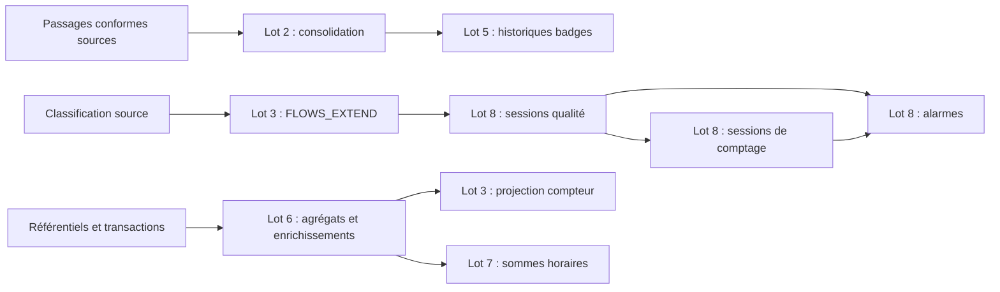

# Rapport détaillé — migration ksqlDB vers Flink

Date : 27 octobre 2026. Périmètre : dépôt `SteelDevAndroid/ksql2flink` et laboratoire local.
Source fonctionnelle : `kafka_streams_recovery.log`, commit de référence
`3e36d34bee855ea944dbfb665c5beb56f38c7a92`. Le journal original est conservé.

## 1. Conclusion et décision proposée

Les **37 traitements persistants recensés disposent d’une implémentation Flink**.
Les tests différentiels documentés comparent les sorties aux requêtes ksqlDB du
journal. Pour les lots 7/8, cinq scénarios ont comparé 91 sorties par moteur ; les
tests de non-régression des lots 5/6 ont également passé lors de cette dernière validation.

**Décision proposée : poursuivre en préproduction avec exécution parallèle sur des
sorties isolées. La bascule de production reste conditionnée aux critères de la section 10.**
Ce rapport ne vaut pas autorisation de déploiement ni certificat d’équivalence pour
des données, incidents ou ordres d’arrivée qui ne figurent pas dans les essais.

Trois niveaux doivent rester distincts :

| Niveau | Situation constatée |
| --- | --- |
| Couverture de conversion | 37/37 traitements implémentés ; inventaire mis à jour |
| Équivalence observée | Démontrée sur les jeux et conditions décrits par lot |
| Aptitude à la production | À qualifier : concurrence, reprise, charge, données invalides et bascule |

Les lots 7/8 sont développés sur la branche `feat/lots-7-8-migration`.
Le statut d’intégration et les vérifications distantes sont à relever dans la PR
associée à la livraison. Les preuves locales décrites ici ne prouvent pas, à elles
seules, une intégration dans la branche principale ni une exécution de CI distante.

## 2. Inventaire et couverture

Le journal contient 57 déclarations : 50 streams et 7 tables. Les traitements
persistants représentent 26 CSAS/CTAS et 11 INSERT distincts, soit 37 traitements.
Les répétitions du journal et les déclarations de sources ne constituent pas des
traitements supplémentaires à migrer.

| Lot | Nombre | Difficulté | Famille | Implémentation principale |
| --- | ---: | --- | --- | --- |
| 1 | 5 | Faible | Lexhistoric ASF, ESC, ARS, ACR, COF | SQL et fonction de compatibilité JSON |
| 2 | 9 | Faible | Consolidation passages conformes | SQL, source multi-topics et projection selon les schémas |
| 3 | 2 | Faible | Extension classification, projection compteur | SQL et décodage de clé INTEGER |
| 4 | 8 | Moyenne | Coffres, bols et synoptiques FAV | SQL, UNNEST et fonctions JSON |
| 5 | 4 | Élevée | Historiques badges CARDME/CIP | SQL et transformation Java des historiques |
| 6 | 4 | Élevée | Référentiels et enrichissement Socle ET | Job DataStream `lab.SocleEtJob` |
| 7 | 1 | Élevée | Indicateurs horaires | Job DataStream `lab.WindowJob` |
| 8 | 4 | Très élevée | Sessions qualité, comptage, deux alarmes | Job DataStream `lab.WindowJob` |
| Total | 37 | | | |

L’entrée ARS des passages conformes est déclarée dans le journal, mais aucune
requête ne l’insère dans le flux consolidé d’entrée. Son exclusion est volontaire.
L’ajouter modifierait le périmètre métier.

L’inventaire nominatif et les lignes du journal sont dans
[query-inventory.json](query-inventory.json) et [migration-plan.md](migration-plan.md).
Le [tableau de mapping ksqlDB → Flink](mapping-ksql-flink.md) donne, pour chacun des
37 traitements, un lien vers la requête ksqlDB, son implémentation SQL ou DataStream
Flink, la transformation conservée et le topic de sortie. Il explicite les
regroupements de plusieurs requêtes dans un même INSERT Flink.

## 3. Architecture livrée

Le laboratoire utilise Kafka et ksqlDB 7.9.2, Flink 1.20.3 sous Java 17, et le
connecteur Kafka SQL 3.4.0-1.20. Docker Compose déploie un broker unique, ksqlDB,
un JobManager et un TaskManager. Le CLI ksqlDB et le client SQL Flink sont disponibles.

Les traitements SQL utilisent des fonctions de compatibilité pour conserver les
contrats JSON et Kafka. Les traitements à état des lots 6–8 utilisent DataStream
pour piloter les déclenchements de jointure, les émissions intermédiaires, les
tombstones et la sérialisation des clés de fenêtres.

Ce diagramme représente les principales dépendances fonctionnelles ; il ne
remplace pas l’inventaire des topics. Lexhistoric et les familles du lot 4 possèdent
leurs propres entrées. Les topics intermédiaires exploded, référentiels, qualité
et comptage sont conservés physiquement.

Les sorties de comparaison sont suffixées `.flink`. Certaines entrées lisent par
défaut les topics historiques afin de comparer les moteurs sur les mêmes données.
**Le câblage d’une chaîne entièrement Flink doit donc être explicité avant bascule.**

| Consommateur | Entrée amont à raccorder pour une chaîne Flink |
| --- | --- |
| Lot 5 | Sorties consolidées entrée/sortie du lot 2, suffixées `.flink` |
| Projection compteur du lot 3 | `VA_PEAGE_BACKOFFICE_SOCLEET_FILTER_REF_COMPTEUR.flink` |
| Lot 7, `indicator_input` | `VA_PEAGE_BACKOFFICE_SOCLEET_FILTER_REF_INDICATEUR.flink` |
| Lot 8, `flows` | `VA_PEAGE_CLASSIFICATION_FLOWS_EXTEND.flink` |
| Lots 6 et 8, lectures intermédiaires | Les lecteurs doivent désigner les topics réellement écrits par le même moteur |

Ces raccordements sont un plan de déploiement à réaliser ; ce rapport ne les
applique pas aux configurations ni aux systèmes externes.

## 4. Définition de l’équivalence attendue

L’équivalence fonctionnelle doit porter sur les règles de filtre, de projection,
de transformation, d’agrégation et de jointure. Elle inclut aussi le contrat Kafka :
clés, schémas de valeurs, timestamps, multiplicité et suppressions.

| Dimension | Ce que les essais établissent | Limite |
| --- | --- | --- |
| Valeurs JSON | Comparaisons structurelles, champs et nulls selon les cas par lot | Pas une égalité octet à octet des valeurs JSON |
| Clés | Comparaison des octets encodés en base64 | Types hors contrat non certifiés |
| Timestamps | Comparaison des timestamps Kafka | Pas une égalité de l’heure murale d’émission |
| Doublons | Conservation des multiplicités attendues | Doublons après panne non qualifiés |
| Tombstones | Propagation ou filtrage selon le traitement | Historique compacté ou expiré à étudier |
| Partitions | Comparées pour les lots 7/8 | Non imposées identiques dans les essais des lots précédents |
| Ordre | Comparé par clé physique et partition pour les lots 7/8 | Aucun ordre global inter-topics/inter-partitions |
| Reprise | Checkpoints disponibles dans le laboratoire | Aucun essai de panne ne certifie encore l’équivalence de reprise |

Les offsets de sortie des deux moteurs ne sont pas tenus d’être identiques. Un
offset est une position dans une partition d’un topic donné, pas un identifiant
métier transférable entre les topics miroirs.

## 5. Points de compatibilité par famille

### Lots 1 et 2

Lexhistoric utilise le premier paiement retenu, le premier PAN et les quatre
correspondances historiques des modes de règlement. La position `[1]` ksqlDB
correspond au premier élément, donc à l’index JSON `[0]`. Les clés de sortie restent
nulles lorsque les sources ne déclarent aucune colonne KEY.

La consolidation lit les topics réseau dans une source multi-topics, sans déduplication. La projection JSON retire
les champs inconnus et matérialise les champs déclarés absents à null. Les noms
quotés respectent leur casse ; les identifiants non quotés suivent le comportement
observé sans tenir compte de la casse. Un tableau nul reste distinct d’un tableau vide.

### Lots 3 et 4

La concaténation station/voie conserve le comportement historique des nulls et
l’absence de séparateur. Les éventuelles collisions ne sont pas corrigées pendant
la migration. La projection compteur utilise la clé INTEGER Kafka de quatre octets.

Les explosions de bols conservent l’ordre et les répétitions ; elles ne propagent
pas les tombstones comme une projection d’identité. Les mappings de positions,
les exclusions MRB propres à ESC et les différences ASF/ESC des FAV sont conservés.
Les comparaisons de structures FAV portent sur leur contenu, pas sur leur mise en forme JSON.

### Lot 5

Une seule explosion par événement filtré conserve la relation PAN/historique/D_VET.
Des explosions indépendantes pourraient créer un produit cartésien incorrect.
Les transformations CARDME et CIP gardent leurs propres règles de padding,
construction de gare, date par concaténation et division des montants par 100.
Les sentinelles PAN proviennent des littéraux du journal, sans généralisation à
toutes les chaînes de zéros.

### Lot 6

Les agrégats COUNT comptent les références acceptées, doublons compris. Les champs
LATEST_BY_OFFSET suivent l’arrivée acceptée ; le timestamp de l’agrégat conserve
le maximum des timestamps acceptés. Une dernière arrivée peut donc avoir une date
plus ancienne sans faire reculer le timestamp de sortie.

Les mises à jour de référentiel ne réémettent pas les transactions passées.
Seules les transactions déclenchent les enrichissements. Les tombstones des tables
matérialisées effacent la valeur de recherche sans rétracter les faits déjà émis.
Cette distinction correspond au contrat des jointures stream-table ksqlDB.
[Documentation Confluent](https://docs.confluent.io/platform/current/ksqldb/developer-guide/joins/join-streams-and-tables.html).

### Lots 7 et 8

Les indicateurs utilisent des fenêtres horaires UTC et le timestamp Kafka, pas
la date métier du JSON. La grâce effective de la configuration historique 7.9.2
est de 23 heures après la fin de la fenêtre horaire. La justification propre à cette
version est documentée dans [lots-7-8.md](lots-7-8.md).

Les sessions ont un gap de 60 minutes. Leurs bornes sont celles des événements ;
leur extension et leur fusion peuvent retirer d’anciennes clés avec des tombstones.
Les mises à jour d’une session ponctuelle au même timestamp n’ajoutent pas ces
suppressions. Le timestamp du tombstone conserve la fin de l’ancienne session.

Les seuils qualité restent strictement ratio > 0,3 et nombre de passages >= 20.
Le comptage distinct utilise HyperLogLog(14) de la bibliothèque ksqlDB 7.9.2.
Une substitution par un comptage exact pourrait changer le franchissement de 30 voies.

Les alarmes conservent la jointure symétrique de ±60 secondes et les seuils
respectifs < 30 et >= 30. La clé globale contient SOCIETE ; ce champ n’est pas
dupliqué dans sa valeur. Le format d’heure locale Europe/Paris avec suffixe Z
littéral est préservé, même s’il peut prêter à confusion pour un consommateur.
Toute correction de ce format doit constituer une évolution métier séparée.

## 6. Résultats et traçabilité des essais

Les SQL ksqlDB extraits du journal constituent l’oracle. Les runners adaptent les
noms, topics et paramètres de déploiement du laboratoire. Les jeux des premiers
lots comportent aussi des sorties attendues explicites. Les lots à état ordonnent
les phases avec des barrières d’offsets committés.

| Périmètre | Sorties par moteur | Preuve locale | Nature de la preuve |
| --- | ---: | --- | --- |
| Lot 1 | 40 | `artifacts/lex23d2edb1/comparison.json` | Validation précédente documentée, rapport présent |
| Lot 2 | 90, dont 40 entrée et 50 sortie | `artifacts/confd3e6f4d2/comparison.json` | Validation précédente documentée, rapport présent |
| Lots 3/4 | 124 | `artifacts/lot347d451791/comparison.json` | Validation précédente documentée, rapport présent |
| Lot 5 | 35 | `artifacts/badge561c6186/comparison.json` | Non-régression de la dernière session |
| Lot 6 | 26 | `artifacts/socle4e90cf39/comparison.json` | Non-régression de la dernière session |
| Lot 7, horaire | 7 | `artifacts/winhourly0ecfd1ff/comparison.json` | Dernière validation locale |
| Lot 8, qualité | 17 | `artifacts/winquality79599734/comparison.json` | Dernière validation locale |
| Lot 8, comptage | 42 | `artifacts/wincountc06d29bd/comparison.json` | Dernière validation locale |
| Lot 8, deux alarmes | 21 | `artifacts/winalarmsd55a3c59/comparison.json` | Dernière validation locale |
| Chaîne lots 7/8, cas contrôlé | 4 | `artifacts/winpipelined2b10204/comparison.json` | Dernière validation locale |

Les 91 sorties des lots 7/8 correspondent à plusieurs scénarios, dont des sorties
intermédiaires et des tombstones. Ce nombre n’est ni un volume de production ni un
nombre d’événements métier distincts. Les résultats des lots précédents ne sont
pas présentés comme une nouvelle exécution intégrale réalisée pour ce rapport.

Les rapports sont présents localement à la rédaction, mais `artifacts/` est ignoré
par Git. La CI prévoit leur publication avec une conservation de sept jours.
Pour une décision de production, archiver un dossier de preuves durable comprenant
rapport, fixtures, SQL effectifs, journaux, versions d’images et révision exacte testée.

## 7. Limites qui empêchent encore une garantie générale d’iso

**Concurrence des flux.** Les tests du lot 6 imposent l’ordre entre références et
transactions. Ceux du lot 8 fournissent un historique contrôlé aux deux côtés de
la jointure. Les arrivées réellement concurrentes peuvent être entrelacées
différemment par les deux moteurs. ksqlDB ne garantit lui-même qu’une synchronisation
best effort des jointures stream-table.
[Documentation Confluent](https://docs.confluent.io/platform/current/ksqldb/developer-guide/joins/join-streams-and-tables.html).

**Historique des états.** Les états ksqlDB ne sont pas importés automatiquement dans
Flink. Un topic compacté ne contenant que la dernière référence ne suffit pas à
reconstruire le COUNT historique du lot 6. Les sessions, compteurs et dernières
valeurs nécessitent chacun une stratégie de reconstruction ou d’initialisation validée.

**Pannes et doublons.** Les sinks livrés sont at-least-once. La présence de checkpoints
ne transforme pas à elle seule les écritures Kafka en exactly-once de bout en bout.
Il faut des sources rejouables et des sorties transactionnelles ou idempotentes,
puis tester le contrat réellement observé.
[Documentation Flink](https://nightlies.apache.org/flink/flink-docs-stable/docs/learn-flink/fault_tolerance/).

**Données invalides.** Certaines fonctions Java échouent sur JSON malformé ou type
incompatible ; ksqlDB peut journaliser et ignorer le message. Il faut définir et
tester une politique commune, y compris la destination des rejets et le décompte des pertes.

**Infrastructure.** Le broker unique, la réplication 1, les checkpoints sur volume
local et l’absence de restauration automatique constituent un laboratoire. Ils
n’établissent aucune disponibilité en cas de perte d’hôte. Certains accès Kafka et
le nombre de partitions sont liés à la configuration de ce laboratoire.

**Charge et observabilité.** Débit maximal, latence, mémoire, taille d’état, durée
des checkpoints et comportement en rattrapage ne sont pas mesurés ici. Les listes
et parcours d’état du job de fenêtres nécessitent une qualification sur la
cardinalité et les retards réels avant engagement de capacité.

## 8. Registre des risques et actions

| Priorité | Risque | Action et preuve demandée | Responsable proposé |
| --- | --- | --- | --- |
| P0 | États incomplets lors du démarrage | Prouver la reconstructibilité de chaque agrégat ; traiter le COUNT historique | Équipe données |
| P0 | Résultats différents en concurrence | Rejouer des entrelacements contrôlés puis le trafic représentatif ; arbitrer les écarts métier | Développement et métier |
| P0 | Doublons/pertes à la bascule ou au retour | Répéter la procédure de frontière d’offsets et de réconciliation | Exploitation et données |
| P0 | Perte d’état après panne d’hôte | Stockage durable, restauration éprouvée, mesure du temps de reprise | Plateforme |
| P1 | Politique de rejet divergente | Tests de JSON invalides, types erronés et clés incompatibles | Développement |
| P1 | Cadence différente des mises à jour | Relever caches et commits effectifs en production, comparer les changelogs | Exploitation |
| P1 | Saturation des états ou du rattrapage | Essais de charge aux pics et sur le retard observé | Plateforme |
| P1 | Mauvais raccordement entre lots | Inventaire des producteurs/consommateurs et revue de configuration | Développement |
| P1 | Incompatibilité des consommateurs | Vérifier clé binaire, partition, tombstones et format des dates sur chaque client | Équipes consommatrices |
| P2 | Perte des preuves de validation | Archivage durable lié à une révision et à des images identifiées | Qualité |

P0 bloque la bascule générale. Les responsables sont des rôles proposés, sans
affectation nominative ni engagement d’échéance.

## 9. Stratégie recommandée

Commencer par les familles sans état après qualification des schémas et des
consommateurs. Traiter ensuite les badges et les dépendances du Socle ET. Les
sessions et alarmes nécessitent une validation supplémentaire des séquences de
mises à jour et de leur concurrence.

L’ordre de bascule est celui des dépendances, pas simplement celui des numéros :
le lot 6 alimente la projection compteur du lot 3 et l’horaire du lot 7 ; le lot 3
alimente le lot 8 ; le lot 2 alimente le lot 5. Une migration partielle peut lire
des topics historiques, à condition que ce choix soit explicite dans la matrice de câblage.

Préférer une exécution parallèle sur des topics séparés, avec contrôle des
consommateurs, à un changement simultané de tous les producteurs. Le guide
[conseils-migration.md](conseils-migration.md) détaille les phases et le retour arrière.

## 10. Critères de décision avant production

| Critère | Condition de passage | État à la rédaction |
| --- | --- | --- |
| Version déployée | Révision et images identifiées, pipeline exécuté sur ces éléments | À figer pour la livraison |
| Contrats | Clés, valeurs, partitions, timestamps, tombstones validés avec les consommateurs | Partiel : laboratoire |
| Écarts déterministes | Aucun écart non expliqué sur les scénarios contractuels | Conforme sur les scénarios documentés |
| Concurrence | Tous les écarts observés classifiés, contrat métier validé | À qualifier |
| États initiaux | Historique ou initialisation correcte démontrée pour chaque état | À qualifier |
| Pannes | Reprise et réconciliation éprouvées sur incidents représentatifs | À qualifier |
| Charge | Objectifs de débit/latence et budget de rattrapage définis puis atteints | À définir et mesurer |
| Bascule | Répétition de la procédure avec preuves des frontières et de l’unicité des effets | À réaliser |
| Retour arrière | Répétition incluant les événements postérieurs à la bascule | À réaliser |
| Approbation | Validation par les responsables métier, données, consommateurs et exploitation | À obtenir pour la production |

Un test vert sur données synthétiques ne lève pas les critères encore ouverts.
Les objectifs de disponibilité, de perte admissible, de reprise et de latence
doivent être fixés par le projet ; aucune valeur arbitraire n’est assimilée ici à un engagement.

## 11. Documents et code de référence

* [Tableau de mapping des 37 requêtes ksqlDB vers Flink](mapping-ksql-flink.md).
* [Guide opérationnel et conseils](conseils-migration.md).
* [Plan et inventaire détaillé](migration-plan.md).
* [Contrat lot 2](lot-2-conformite.md), [lots 3/4](lots-3-4.md),
  [lots 5/6](lots-5-6.md), [lots 7/8](lots-7-8.md).
* [Job Socle ET](../docker/flink/src/lab/SocleEtJob.java) et
  [job fenêtres et alarmes](../docker/flink/src/lab/WindowJob.java).
* [Suite fenêtres et alarmes](../scripts/test_windows.py) et
  [workflow de validation](../.github/workflows/migration-tests.yml).
